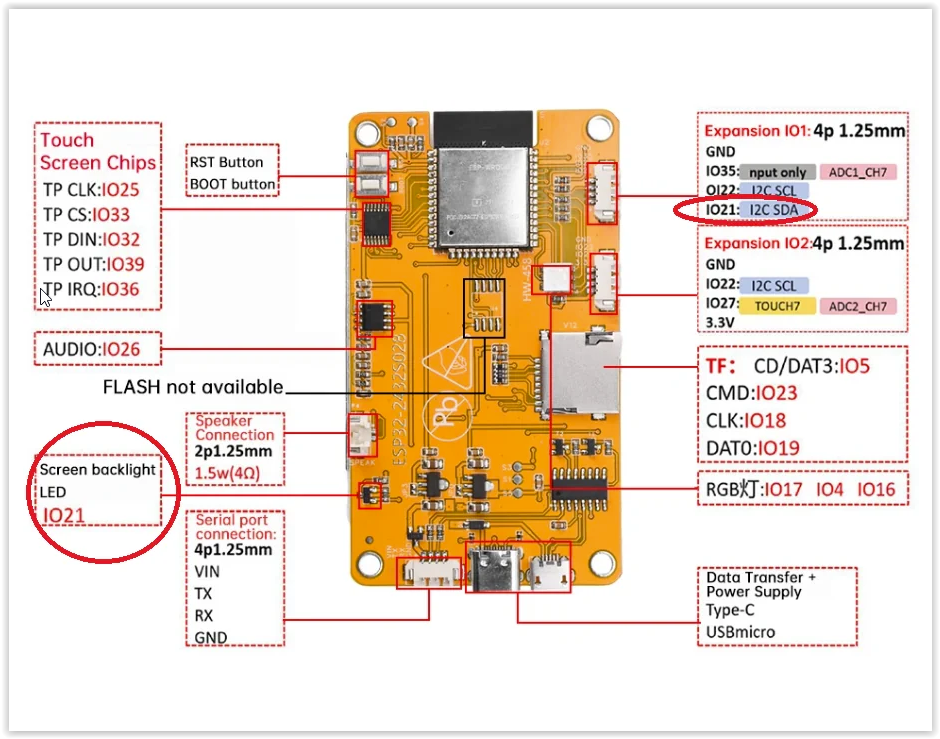
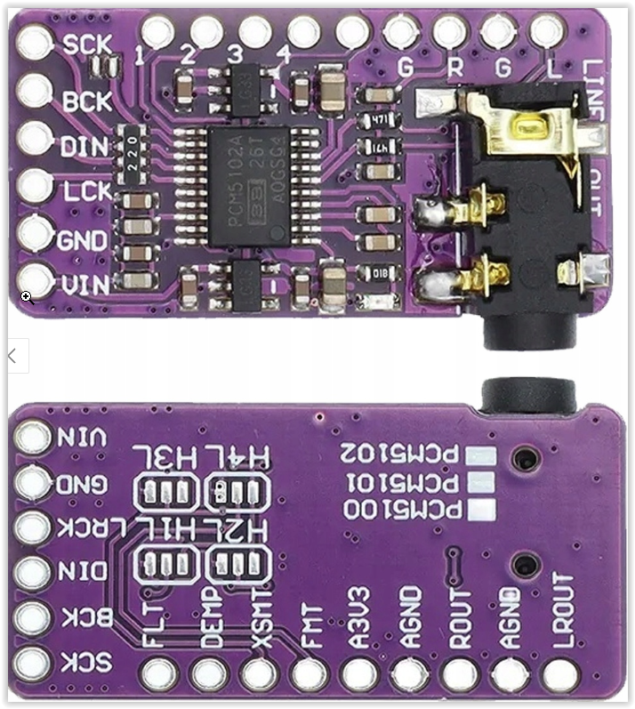
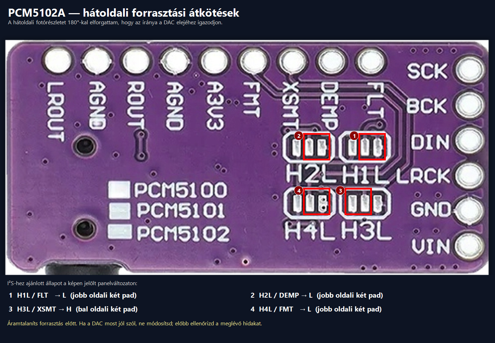
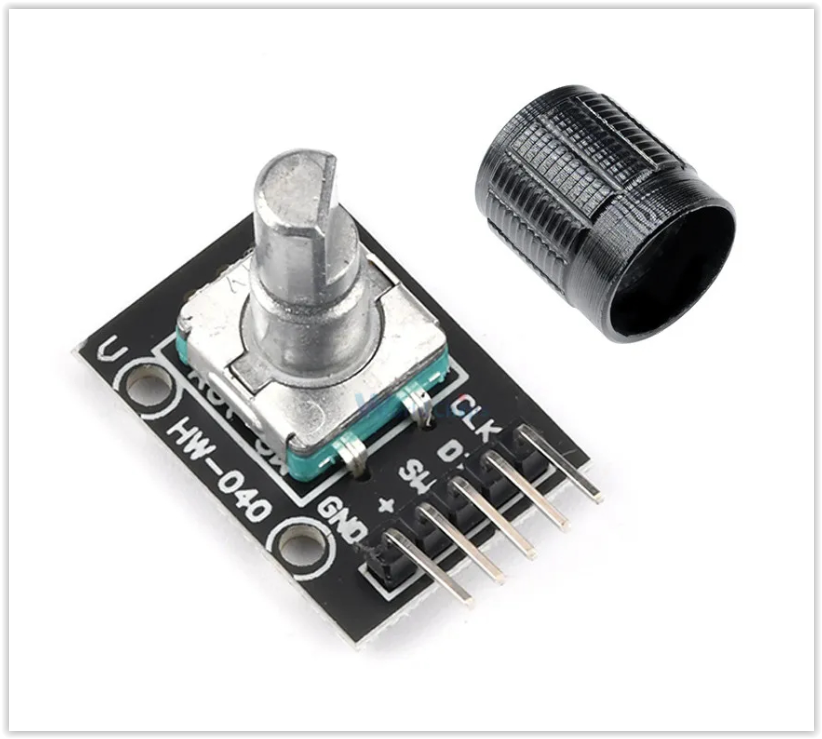
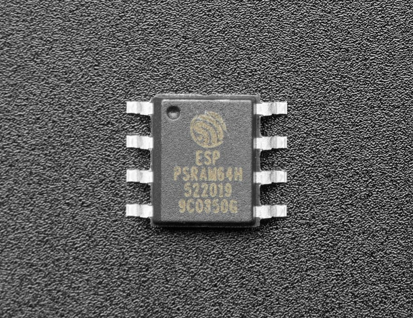
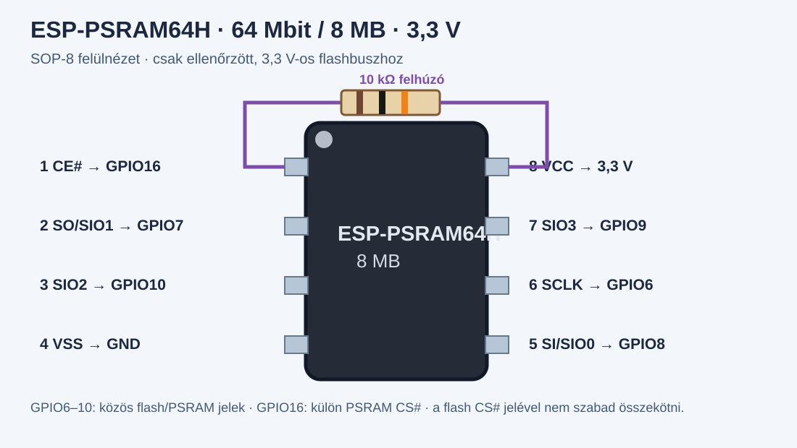
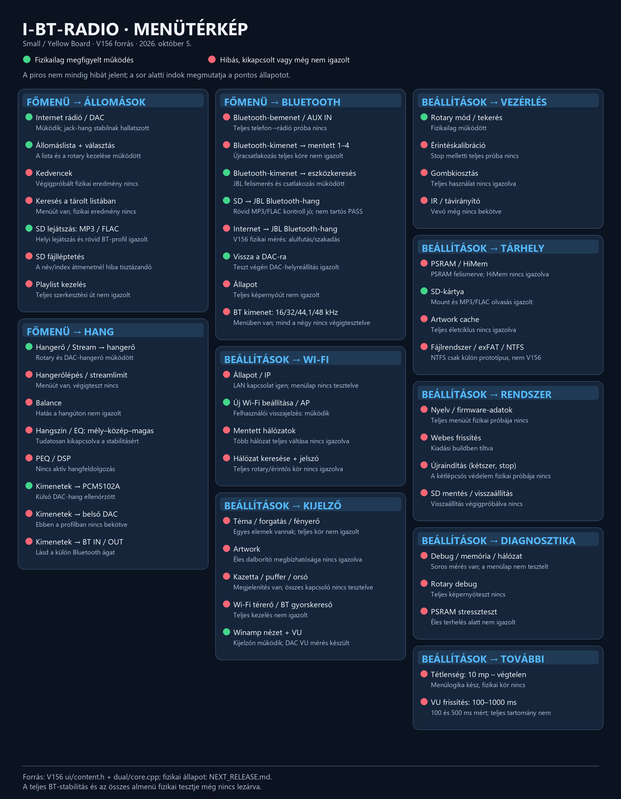

# I-BT-Radio — V166-R137 BETA · 17. Oktober 2026

[Magyar](README.md) · [English](README.en.md)

Ich entwickle mein eigenes yoRadio-basiertes ESP32-WROOM-Radio mit PSRAM und konzentriere mich auf SMALL. [Funktionsstand](docs/Features.md) · [Menü](docs/menu/README.md) · [Anschlüsse](hardware/README.md).

Im R136-DAC-Test derselben 15 Beispieldateien erreichte die PCM-Erzeugung 98,44–99,60% der Echtzeit. Opus belastete Core1 noch mit 94,1%. In R137 habe ich die überflüssige Einzelkonvertierung bei der PCM16-Übergabe entfernt. Build und Hosttests sind erfolgreich; im R137-Test derselben 15 Dateien lag Opus Core1 bei 87,5%, die PCM-Erzeugung bei 99,40%. Pro Datei liegt ein sauberes CPU-Fenster von etwa 9 Sekunden vor; das belegt weder Dauerlast noch hörbare Qualität. ALAC24 erreichte 91,3% Core1 und 97,33% PCM und bleibt zu untersuchen. Die Sicherheitsgrenzen bleiben unverändert.

Radio → DAC, SD → DAC und zuvor Telefon → BT-IN → DAC funktionierten am Gerät. SD → BT lief auch mit JBL; Pufferaussetzer und hohe Prozessorlast bleiben offen. WLAN-Audio → BT und EQ-Signalverarbeitung bleiben abgeschaltet. Wecker, BLE und Wetter brauchen weitere Tests. Die Touch-Menüdemo auf dem 800×480-Panel ESP32-8048S070C lief; sie ist noch kein vollständiger Radio-Port.

## Skins

Aktualisiert: 17. Oktober 2026 · V166-R137 Entwicklung

Ich zeige elf Skins und die beiden einfachen Systemansichten: Basisplayer und BT-IN. Die Vorschauen sind zentriert und 320 Pixel breit. Frühere Layout-Vorschauen, statische Hintergründe und mit Zeichencode erzeugte Ansichten kennzeichne ich getrennt. Sie ersetzen keinen Anzeigetest am Gerät.

Winamp, BT-IN, Service und Kajon-Jon-bt-vu sind Ausnahmen: Ihr Quellcode darf veröffentlicht werden. Dieses Galerie-Update enthält nur Bilder und Beschreibungen.

<h3 align="center">Winamp / Classic</h3>

<em>Frühere Layout-Vorschau.</em>

<h3 align="center">Media Player</h3>

<em>Frühere Layout-Vorschau. Auf Wunsch des Auftraggebers halte ich den Quellcode auf unbestimmte Zeit privat. Auf gesonderte Anfrage veröffentliche ich ihn mit Erlaubnis des Eigentümers.</em>

<h3 align="center">Cassette</h3>

<em>Statischer Hintergrund; Metadaten erscheinen bei der Wiedergabe. Auf Wunsch des Auftraggebers halte ich den Quellcode auf unbestimmte Zeit privat. Auf gesonderte Anfrage veröffentliche ich ihn mit Erlaubnis des Eigentümers.</em>

<h3 align="center">Kajon-Jon-bt-vu</h3>

<em>Frühere Layout-Vorschau mit Zeigeranzeigen.</em>

<h3 align="center">Service</h3>

<em>Signalgenerator und Diagnose; kein kalibriertes Messgerät.</em>

<h3 align="center">Classic Wood</h3>

<em>Statischer Hintergrund ohne dynamische Beschriftung. Auf Wunsch des Auftraggebers halte ich den Quellcode auf unbestimmte Zeit privat. Auf gesonderte Anfrage veröffentliche ich ihn mit Erlaubnis des Eigentümers.</em>

<h3 align="center">Vintage HiFi</h3>

<em>Statischer Hintergrund ohne dynamische Beschriftung. Auf Wunsch des Auftraggebers halte ich den Quellcode auf unbestimmte Zeit privat. Auf gesonderte Anfrage veröffentliche ich ihn mit Erlaubnis des Eigentümers.</em>

<h3 align="center">Retro Neon</h3>

<em>Statischer Hintergrund; das separate Vintage-Thema. Auf Wunsch des Auftraggebers halte ich den Quellcode auf unbestimmte Zeit privat. Auf gesonderte Anfrage veröffentliche ich ihn mit Erlaubnis des Eigentümers.</em>

<h3 align="center">Neon</h3>

<em>Vorschau mit R137-Zeichencode, Beispieldaten und illustrativem Spektrum. Auf Wunsch des Auftraggebers halte ich den Quellcode auf unbestimmte Zeit privat. Auf gesonderte Anfrage veröffentliche ich ihn mit Erlaubnis des Eigentümers.</em>

<h3 align="center">Ébresztőóra / Alarm clock</h3>

<em>R124-Uhrvorschau mit Beispieldaten und aktiviertem Fotohintergrund. Auf Wunsch des Auftraggebers halte ich den Quellcode auf unbestimmte Zeit privat. Auf gesonderte Anfrage veröffentliche ich ihn mit Erlaubnis des Eigentümers.</em>

<h3 align="center">Időjárás / Weather</h3>

<em>R130-Nachtvorschau mit Beispieldaten; keine aktuelle Wettermessung. Auf Wunsch des Auftraggebers halte ich den Quellcode auf unbestimmte Zeit privat. Auf gesonderte Anfrage veröffentliche ich ihn mit Erlaubnis des Eigentümers.</em>

<h3 align="center">Alapnézet / Basic player</h3>

<em>R137-Basisansicht mit Beispieldaten. Auf Wunsch des Auftraggebers halte ich den Quellcode auf unbestimmte Zeit privat. Auf gesonderte Anfrage veröffentliche ich ihn mit Erlaubnis des Eigentümers.</em>

<h3 align="center">Bluetooth IN</h3>

<em>R137-BT-IN-Bildschirm mit Beispieldaten, ohne Cover.</em>

WLAN-Audio → BT bleibt gesperrt, die EQ-Signalverarbeitung abgeschaltet. Die Winamp-EQ-Kurve ist dekorativ. Dieses Galerie-Update ist keine neue öffentliche Firmware-Veröffentlichung.

## Hardware und Anschlüsse

Die folgende Belegung entspricht der dokumentierten Small/Yellow-Board-Ausführung mit 320 × 240 Pixeln. Platinenrevision vor dem Löten vergleichen.

**Die eingebaute RGB-LED muss vor der Nutzung von GPIO4, GPIO16 und GPIO17 entfernt werden.** Der interne Lautsprecherverstärker wird nicht verwendet. Seine mögliche elektrische Belastung an GPIO26 ist bei der jeweiligen Platinenrevision zu prüfen.

### PCM5102A DAC

Die Rückseitenaufnahme wurde um 180° gedreht. I²S-Brücken: **H1L=L, H2L=L, H3L=H, H4L=L**. Ein bereits funktionierendes Modul nicht ohne Prüfung umlöten.

| ESP32 | DAC |
|---|---|
| GPIO22 | BCK / BCLK |
| GPIO17 | DIN / DATA |
| GPIO27 | LCK / LRCK / WSEL |
| GND | GND |
| gemäß konkretem Modul | VIN |
| nicht angeschlossen | SCK / MCLK |

VIN-Spannung am konkreten Modul prüfen. Der DAC liefert ein Line-Signal und treibt keine passiven Lautsprecher direkt.

### HW-040 Drehgeber

| ESP32 | Drehgeber |
|---|---|
| GPIO26 | CLK / A |
| GPIO35 | DT / B |
| GPIO4 | SW |
| 3,3 V | + / VCC |
| GND | GND |

GPIO35 hat keinen internen Pull-up. Falls das Modul keinen enthält, **10 kΩ zwischen DT/GPIO35 und 3,3 V** einsetzen. Keine 5 V an die GPIOs legen.

### ESP-PSRAM64H

**ESP-PSRAM64H: 64 Mbit / 8 MB, 3,3 V, SOP-8-150 mil.**

| Pin | Signal | Anschluss |
|---:|---|---|
| 1 | CE# / CS# | GPIO16, 10 kΩ nach 3,3 V |
| 2 | SIO1 | GPIO7 |
| 3 | SIO2 | GPIO10 |
| 4 | VSS | GND |
| 5 | SIO0 | GPIO8 |
| 6 | SCLK | GPIO6 |
| 7 | SIO3 | GPIO9 |
| 8 | VCC | 3,3 V |

GPIO6–10 sind gemeinsam genutzte Flash-/PSRAM-Bussignale, keine freien GPIOs. PSRAM-CS an GPIO16 ist vom Flash-CS getrennt. Beim klassischen ESP32 sind gewöhnlich höchstens 4 MB direkt abgebildet; der übrige Speicher benötigt HiMem-Unterstützung.

| Typ | Kapazität | Spannung |
|---|---:|---:|
| ESP-PSRAM32 | 4 MB | 1,8 V |
| ESP-PSRAM32H | 4 MB | 3,3 V |
| ESP-PSRAM64 | 8 MB | 1,8 V |
| ESP-PSRAM64H | 8 MB | 3,3 V |

Als Alternativen sind ESP-PSRAM64H oder LY68L6400SLI(T) mit passendem 3,3-V-SOP-8-Gehäuse dokumentiert; ESP-PSRAM32H hat nur 4 MB. Die 1,8-V-Typen sind kein direkter Ersatz. [Lyontek-Datenblatt](https://www.lyontek.com.tw/pdf/ddr/LY68L6400-1.2.pdf) · [ESP-IDF-Unterstützung](https://github.com/espressif/esp-idf/blob/v5.5.5/components/esp_psram/esp32/Kconfig.spiram).

### Weitere belegte Pins

| Funktion | GPIO |
|---|---|
| TFT | CS15, DC2, SCK14, MISO12, MOSI13, Hintergrundlicht21 |
| Touch | SCK25, MISO39, MOSI32, CS33, IRQ36 |
| SD | SCK18, MISO19, MOSI23, CS5 |
| Lichtsensor | GPIO34 |

Grün kennzeichnet vorhandene Funktionsrückmeldungen. Rot kennzeichnet deaktivierte, fehlerhafte oder noch zu prüfende Funktionen. Die historische V156-Karte ist kein vollständiger Stabilitätsnachweis und bildet das neue Oberflächenmenü noch nicht ab.

## Fehler melden

[GitHub Issues](https://github.com/szupert/I-BT-Radio-/issues): Firmwareversion, Platine, Quelle (Internet/SD), Ausgang (DAC/BT), Bluetooth-Gerät, genaue Schritte und Zeitpunkt des Fehlers angeben. WLAN-Passwörter, SSIDs und andere persönliche Daten vor dem Hochladen aus Protokollen entfernen. Weitere Details: [Hardwaredokumentation](hardware/README.md).

## Unterstützung

Wenn du das Projekt unterstützen möchtest, kannst du das hier tun. Von den Spenden kaufe ich neue ESP-Boards, weitere von euch vorgeschlagene Boards und Entwicklungswerkzeuge, damit ich das Radio auf mehr Hardware nutzbar machen und weiter verbessern kann. Wenn du selbst ein passendes Board hast und es mir zur Verfügung stellen oder zuschicken möchtest, nimm bitte Kontakt mit mir auf.

- **Ethereum (ETH):** `0xf044db3277a1b880713e81d66b6E507F65450EE6`
- **Bitcoin (BTC):** `3KLgXnbCs1WCD3igiVErxdy2CAH7QWchLs`
- **PayPal:** `LT253250028810624563`

[Menüprüfung und bekannte Fehler (Ungarisch)](docs/menu/README.md)
