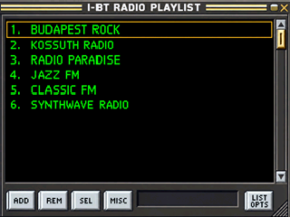

# I-BT-Radio — V166-R125 BETA · 16. Oktober 2026

[Magyar](README.md) · [English](README.en.md)

Ich entwickle mein eigenes, auf yoRadio basierendes Radio mit ESP32-WROOM und PSRAM. SMALL ist das aktive Ziel. [Funktionsstand](docs/Features.md) und [Menübeschreibung](docs/menu/README.md) trennen geprüfte Funktionen von offenen Aufgaben; diese Detailseiten sind auf Ungarisch.

## Funktioniert, wird geprüft, geplant

| Stand | Funktionen |
|---|---|
| Am Gerät erprobt | Internetradio→DAC, SD→DAC, früher auch Telefon→BT-IN→DAC und lokale Bedienung. R124 absolvierte zwei kurze Budapest-Rock/DAC-Phasen mit und ohne Menünavigation. |
| Implementiert, Prüfung läuft | Wochenwecker, Lautstärke-/Helligkeitsrampen, lokaler Ersatzton, NTP/Zeitzone, WebUI, Wetter und Xiaomi-Sensoren, adaptive Anzeige bis 20fps. Nicht jede Kombination ist bereits am Gerät geprüft. |
| R125, Hosttests erfolgreich | Kein unnötiges Warten nach endgültigem BT-Fehler und DAC-Rückfall; neue Verbindungsanfrage getrennt vom alten Fehler; ACL-/Authentifizierungs-/A2DP-Diagnose. BLE-Scan und direkte Abfrage starten zusammen höchstens einmal pro Minute. Gerätetest von R125 steht aus. |
| Bekannte Grenzen | SD→BT scheiterte in R124 bei der A2DP-Dienstsuche, daher keine gültige BT-Puffermessung. WLAN-Audio→BT ist gesperrt. EQ-Signalverarbeitung ist abgeschaltet; Winamp-EQ dient nur der Darstellung. |
| Geplant | BT-Verbindung und verbleibende Stabilitätsfehler beheben; vollständige Wecker-/Schlummertests; Helligkeit und Akku prüfen; Radio Browser; sparsame Android-Fernbedienung; weitere CPU-/RAM-Optimierung. |

Die 800×480-Touch-Menüdemo auf dem ESP32-8048S070C funktionierte am Gerät. Sie ist noch kein vollständiger Radioport. Mit diesem Dokumentationsupdate veröffentliche ich keine neue Firmware.

## Öffentlicher Skin

Nur **Winamp / Classic** bleibt in der aktuellen öffentlichen Galerie. Alle anderen Skins sind **privat**.

Die Bilder sind frühere Entwürfe, keine vollständigen R125-Gerätefotos. Downloads mit mehreren Skins habe ich aus dem aktuellen Zweig entfernt. Früher veröffentlichte Dateien können in der Git-Historie erhalten bleiben; eine Privat-Markierung schützt sie nicht rückwirkend.

## Hardware und Anschlüsse

Die folgende Belegung entspricht der dokumentierten Small/Yellow-Board-Ausführung mit 320 × 240 Pixeln. Platinenrevision vor dem Löten vergleichen.

**Die eingebaute RGB-LED muss vor der Nutzung von GPIO4, GPIO16 und GPIO17 entfernt werden.** Der interne Lautsprecherverstärker wird nicht verwendet. Seine mögliche elektrische Belastung an GPIO26 ist bei der jeweiligen Platinenrevision zu prüfen.

### PCM5102A DAC

Die Rückseitenaufnahme wurde um 180° gedreht. I²S-Brücken: **H1L=L, H2L=L, H3L=H, H4L=L**. Ein bereits funktionierendes Modul nicht ohne Prüfung umlöten.

| ESP32 | DAC |
|---|---|
| GPIO22 | BCK / BCLK |
| GPIO17 | DIN / DATA |
| GPIO27 | LCK / LRCK / WSEL |
| GND | GND |
| gemäß konkretem Modul | VIN |
| nicht angeschlossen | SCK / MCLK |

VIN-Spannung am konkreten Modul prüfen. Der DAC liefert ein Line-Signal und treibt keine passiven Lautsprecher direkt.

### HW-040 Drehgeber

| ESP32 | Drehgeber |
|---|---|
| GPIO26 | CLK / A |
| GPIO35 | DT / B |
| GPIO4 | SW |
| 3,3 V | + / VCC |
| GND | GND |

GPIO35 hat keinen internen Pull-up. Falls das Modul keinen enthält, **10 kΩ zwischen DT/GPIO35 und 3,3 V** einsetzen. Keine 5 V an die GPIOs legen.

### ESP-PSRAM64H

**ESP-PSRAM64H: 64 Mbit / 8 MB, 3,3 V, SOP-8-150 mil.**

| Pin | Signal | Anschluss |
|---:|---|---|
| 1 | CE# / CS# | GPIO16, 10 kΩ nach 3,3 V |
| 2 | SIO1 | GPIO7 |
| 3 | SIO2 | GPIO10 |
| 4 | VSS | GND |
| 5 | SIO0 | GPIO8 |
| 6 | SCLK | GPIO6 |
| 7 | SIO3 | GPIO9 |
| 8 | VCC | 3,3 V |

GPIO6–10 sind gemeinsam genutzte Flash-/PSRAM-Bussignale, keine freien GPIOs. PSRAM-CS an GPIO16 ist vom Flash-CS getrennt. Beim klassischen ESP32 sind gewöhnlich höchstens 4 MB direkt abgebildet; der übrige Speicher benötigt HiMem-Unterstützung.

| Typ | Kapazität | Spannung |
|---|---:|---:|
| ESP-PSRAM32 | 4 MB | 1,8 V |
| ESP-PSRAM32H | 4 MB | 3,3 V |
| ESP-PSRAM64 | 8 MB | 1,8 V |
| ESP-PSRAM64H | 8 MB | 3,3 V |

Als Alternativen sind ESP-PSRAM64H oder LY68L6400SLI(T) mit passendem 3,3-V-SOP-8-Gehäuse dokumentiert; ESP-PSRAM32H hat nur 4 MB. Die 1,8-V-Typen sind kein direkter Ersatz. [Lyontek-Datenblatt](https://www.lyontek.com.tw/pdf/ddr/LY68L6400-1.2.pdf) · [ESP-IDF-Unterstützung](https://github.com/espressif/esp-idf/blob/v5.5.5/components/esp_psram/esp32/Kconfig.spiram).

### Weitere belegte Pins

| Funktion | GPIO |
|---|---|
| TFT | CS15, DC2, SCK14, MISO12, MOSI13, Hintergrundlicht21 |
| Touch | SCK25, MISO39, MOSI32, CS33, IRQ36 |
| SD | SCK18, MISO19, MOSI23, CS5 |
| Lichtsensor | GPIO34 |

Grün kennzeichnet vorhandene Funktionsrückmeldungen. Rot kennzeichnet deaktivierte, fehlerhafte oder noch zu prüfende Funktionen. Die historische V156-Karte ist kein vollständiger Stabilitätsnachweis und bildet das neue Oberflächenmenü noch nicht ab.

## Fehler melden

[GitHub Issues](https://github.com/szupert/I-BT-Radio-/issues): Firmwareversion, Platine, Quelle (Internet/SD), Ausgang (DAC/BT), Bluetooth-Gerät, genaue Schritte und Zeitpunkt des Fehlers angeben. WLAN-Passwörter, SSIDs und andere persönliche Daten vor dem Hochladen aus Protokollen entfernen. Weitere Details: [Hardwaredokumentation](hardware/README.md).

## Unterstützung

Wenn du das Projekt unterstützen möchtest, kannst du das hier tun. Von den Spenden kaufe ich neue ESP-Boards, weitere von euch vorgeschlagene Boards und Entwicklungswerkzeuge, damit ich das Radio auf mehr Hardware nutzbar machen und weiter verbessern kann. Wenn du selbst ein passendes Board hast und es mir zur Verfügung stellen oder zuschicken möchtest, nimm bitte Kontakt mit mir auf.

- **Ethereum (ETH):** `0xf044db3277a1b880713e81d66b6E507F65450EE6`
- **Bitcoin (BTC):** `3KLgXnbCs1WCD3igiVErxdy2CAH7QWchLs`
- **PayPal:** `LT253250028810624563`

[Menüprüfung und bekannte Fehler (Ungarisch)](docs/menu/README.md)
