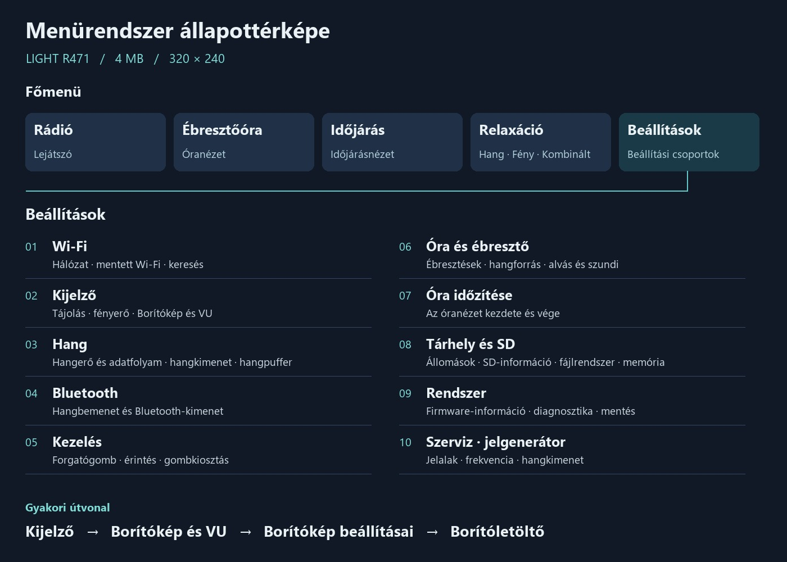
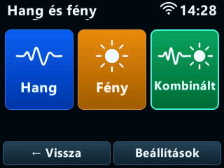
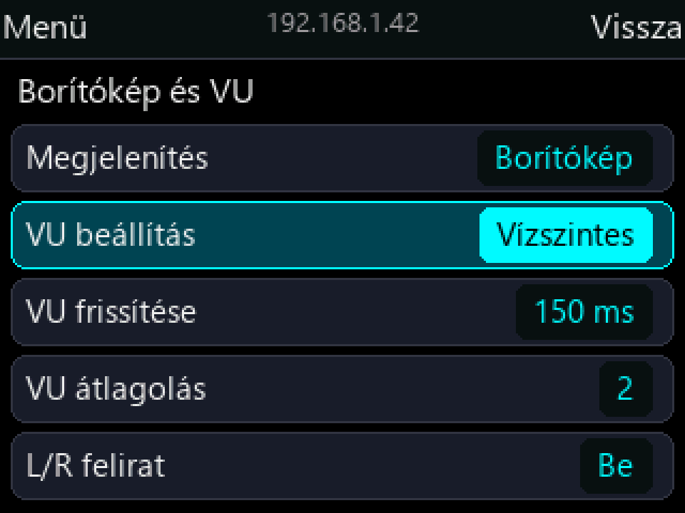
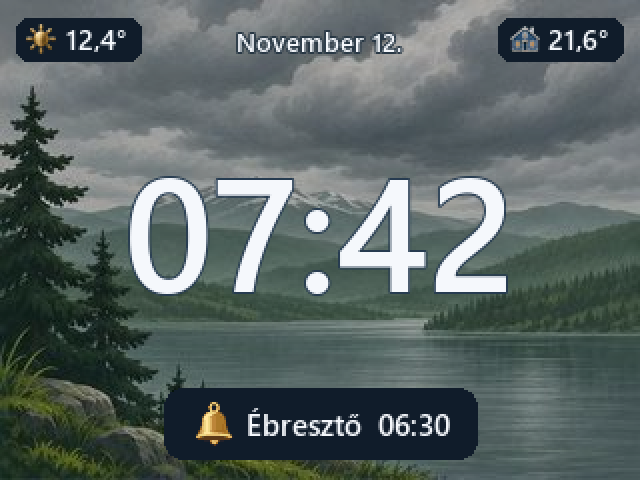
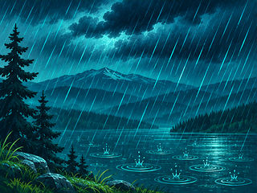

# I-BT-Radio · LIGHT R471

Internetrádió, SD-lejátszó, ébresztőóra és relaxációs programok a klasszikus ESP32-WROOM-os, 320 × 240-es érintőkijelzős rádióhoz. A LIGHT kiadás 4 MB flashsel, PSRAM nélkül fut.

**[R471 tesztkiadás letöltése](https://github.com/szupert/I-BT-Radio-/releases/tag/V166-R471-LIGHT)** · [Telepítés](docs/releases/R471-LIGHT.md) · [Funkciók](docs/Features.md) · [Hardver és bekötés](hardware/README.md)

A nyilvános ZIP meglévő, azonos partíciókiosztású R470 LIGHT rádió frissítésére szolgál. A PRO és a BIG/P4 saját firmware-t használ.

## Rádió és borítóletöltés

A hálózati borítóletöltés leállított webrádiónál indulhat. Wi-Fi → DAC lejátszáskor az MP3- és AAC-puffer elkérheti a letöltő felszabadult, legfeljebb 7 KiB-os munkaterületét. A puffer telítettségét és újratöltéseit a **Beállítások → Hang → Hangpuffer** oldalon követheted.

## Menürendszer állapottérképe

[Menüpontok és kezelési útvonalak szövegesen](docs/menu/README.md)

## Kijelző és programválasztás

| Főmenü | Relaxáció | Álló programlista |
|---|---|---|
|  |  |  |

A három előnézetet a LIGHT felületrajzolójával készítettem.

Óranézet, időjárási hátterek és a Borítókép és VU menü

Óranézet és érintésvezérlés · látványtervek

 

Időjárási hátterek · napos, felhős, esős, havas és fagyos idő

     

## További változatok

[BIG P4 / JC1060](beta/BIG_P4_JC1060_DEV1/README.md) · [Korábbi LIGHT és PRO kiadások, skingaléria és panelbekötések](KORABBI_KIADASOK_ES_SKINEK.md) · [Forrás](source/README.md) · [Licencek](THIRD_PARTY_NOTICES.md)

## Támogatás

Ha szívesen támogatnád a projektet, itt megteheted. A támogatásból új ESP-paneleket, az általatok javasolt más paneleket és fejlesztőeszközöket veszek, hogy többféle hardveren is elérhetővé és jobbá tehessem a rádiót. Ha van ilyen paneled, vagy szívesen küldenél egyet, vedd fel velem a kapcsolatot.

- **Ethereum (ETH):** `0xf044db3277a1b880713e81d66b6E507F65450EE6`
- **Bitcoin (BTC):** `3KLgXnbCs1WCD3igiVErxdy2CAH7QWchLs`
- **PayPal:** `LT253250028810624563`
