# I-BT-Radio · LIGHT R471

Internetrádió, SD-lejátszó, ébresztőóra és relaxációs programok a klasszikus ESP32-WROOM-os, 320 × 240-es érintőkijelzős rádióhoz. A LIGHT kiadás 4 MB flashsel, PSRAM nélkül fut.

**[R471 tesztkiadás letöltése](https://github.com/szupert/I-BT-Radio-/releases/tag/V166-R471-LIGHT)** · [Telepítés](docs/releases/R471-LIGHT.md) · [Funkciók](docs/Features.md) · [Hardver és bekötés](hardware/README.md)

A nyilvános ZIP meglévő, azonos partíciókiosztású R470 LIGHT rádió frissítésére szolgál. A PRO és a BIG/P4 saját firmware-t használ.

[Funkciók](#a-light-funkciói) · [Menütérkép](#menürendszer-állapottérképe) · [Kijelzőképek](#kijelző-és-programválasztás) · [Összes skin](#skinek)

## Melyik rádióhoz?

| Változat | Hardver és kiadás |
|---|---|
| LIGHT | Klasszikus ESP32-WROOM, 320 × 240, 4 MB flash. Az R471 tesztkiadás PSRAM nélkül működik. A fenti ZIP meglévő R470 LIGHT frissítéséhez készült. |
| PRO | A projekt 16 MB flashsel és PSRAM-mal szerelt Yellow Board változata. A panelhez tartozó kiadást és bekötést válaszd. [Korábbi kiadások és bekötések](KORABBI_KIADASOK_ES_SKINEK.md) |
| BIG P4 | A JC1060 fejlesztői csomag 1024 × 600-as érintőkijelzőt, C6 Wi-Fi-t és beépített ES8311 monó hangot használ. Saját telepítője és tesztállapota van. [Kompatibilis panel és letöltés](beta/BIG_P4_JC1060_DEV1/README.md) |

## A LIGHT funkciói

| Mit szeretnél csinálni? | Hol találod, mit állíthatsz? |
|---|---|
| Internetrádiót hallgatni | **Rádió** → állomáslista, kedvencek, keresés és adóváltás. A Wi-Fi-adás a DAC-ra szól. A **Hang → Hangpuffer** oldalon látod a puffer telítettségét és az újratöltéseket. |
| SD-ről vagy Bluetooth-on zenélni | A lejátszóban válthatsz forrást. SD-ről a helyi zenelistát böngészheted. A Bluetooth-menüben elérhető az eszközkeresés, a mentett eszközök, a telefon hangjának fogadása és a Bluetooth-kimenet beállítása. |
| Hangot beállítani | **Hang** → hangerő és adatfolyam, hangkimenet, hangpuffer, DSP monó/sztereó. A **Szerviz** jelgenerátorában jelalak, frekvencia és kimenet választható. |
| Borítót vagy VU-mérőt látni | Állomáslogók, előadói borítók, SD-leltár és külön borítóletöltő. Kép hiányában a VU jelenhet meg. Állítható a sávok iránya, frissítése és átlagolása. **Kijelző → Borítókép és VU**. |
| Ébresztést vagy esti óranézetet beállítani | Négy ébresztés, heti napok, hangforrás, szundi, alvásidő és időzített óranézet. Az órán digitális vagy lapozós kijelzés, három méret, egyedi számjegyszín és kapcsolható kettőspont választható. |
| Időjárást követni | Helyhez kötött Open-Meteo időjárás és kültéri adatok. Az órához napos, felhős, esős, havas és fagyos háttér tartozik, opcionális SD-képcsomaggal. Kompatibilis BLE-hőmérővel beltéri mérés is elérhető. |
| Relaxációs programot indítani | A **Relaxáció** csempe Hang, Fény és Kombinált módot nyit. Program és időtartam választható. A külső fényprogramokhoz bekötött LED szükséges. |
| A kijelzőt és kezelést személyre szabni | Fényerő, álló vagy fekvő nézet, öt menübetűméret, animációk, puffer- és indulási jelzők. Érintéskalibrálás, forgatógomb, gombkiosztás, menübezárás és infrás kezelés megfelelő vevővel. |
| Hálózatot váltani | A **Wi-Fi** menüben vannak a hálózatok, a mentett kapcsolatok és a DNS-beállítások. SD- és Bluetooth-forráshoz hálózat nélküli mód is választható. |
| Tárhelyet, rendszert vagy hibát ellenőrizni | **Tárhely és SD** → állomások és fájlok, SD-kártya, belső tárhely és memória. **Rendszer** → firmware-információ, diagnosztika és mentés. A webes kezelő mellett soros diagnosztika és naplózó selftest segíti a hibakeresést. |

**Mit mutatott az R471 hangpróbája?** PSRAM nélkül, adónként három perc alatt a Budapest Rock 24 KiB puffert kapott és ötször pufferelt újra. A MegaDance 24 KiB mellett egyszer. A Delite AAC 23 KiB mellett nulla újrapufferelést, de 24 dekóder-adathiányt és két csatornaszámhibát jelzett. A mérések a rádió naplójából származnak.

A hálózati borítóletöltés mindhárom mérési ablakban szünetelt. Leállítás után elindult. A Delite sikertelen csatlakozása és az újrapróbálás közötti rövid leállás alatt is indult borítókérés. Lejátszáskor az MP3- és AAC-puffer a borítóletöltő memóriájából legfeljebb 7 KiB-ot használhat.

## Menürendszer állapottérképe

[Menüpontok és kezelési útvonalak szövegesen](docs/menu/README.md)

## Kijelző és programválasztás

| Főmenü | Relaxáció | Álló programlista |
|---|---|---|
| 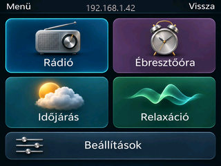 |  | 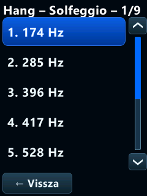 |

A három előnézetet a LIGHT felületrajzolójával készítettem.

Óranézet, időjárási hátterek és a Borítókép és VU menü

Óranézet és érintésvezérlés · látványtervek

 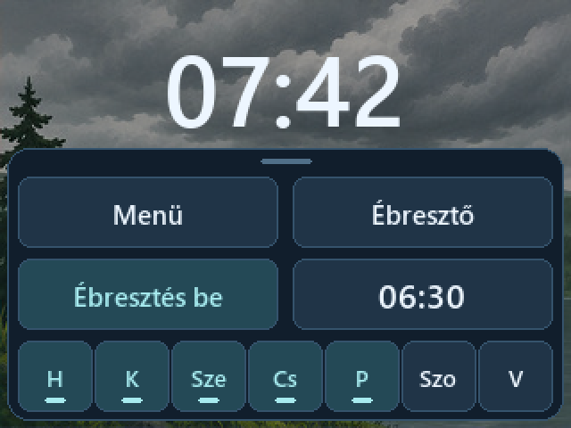

Időjárási hátterek · napos, felhős, esős, havas és fagyos idő

     

## Skinek

A galériában a projekt különböző kiadásainak képernyői láthatók. A választható skinek panelenként és kiadásonként eltérnek.

A korábbi előnézetek mellett most a teljes alkalmazásforrás is elérhető a source könyvtárban.

<h3 align="center">Winamp / Classic</h3>

<table align="center">
<tr><th align="center">Betöltő</th><th align="center">Asztal · 2 mp</th><th align="center">Lejátszó</th></tr>
<tr><td align="center"><a href="skins/classic-player-320x240/boot-xp-r161.jpg">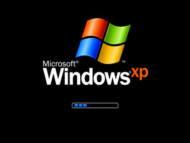</a></td><td align="center"><a href="skins/classic-player-320x240/desktop-xp-r161.png">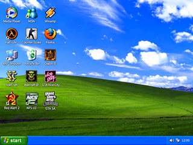</a></td><td align="center"><a href="skins/classic-player-320x240/player_eq.png">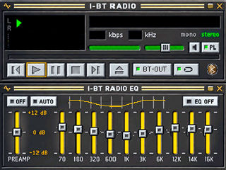</a></td></tr>
</table>

<em>Korábbi grafikai előnézet.</em>

<h3 align="center">Media Player</h3>

<table align="center">
<tr><th align="center">Betöltő</th><th align="center">Asztal · 2 mp</th><th align="center">Lejátszó</th></tr>
<tr><td align="center"><a href="skins/media-player-320x240/boot-win7-r161.jpg">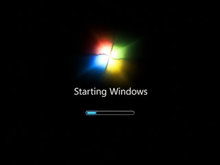</a></td><td align="center"><a href="skins/media-player-320x240/desktop-win7-r161.png">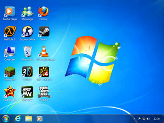</a></td><td align="center"><a href="skins/media-player-320x240/player.png">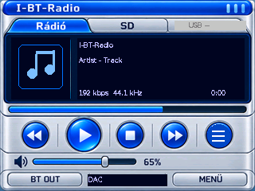</a></td></tr>
</table>

<em>Korábbi grafikai előnézet. Forráskód: <a href="https://github.com/szupert/I-BT-Radio-/tree/main/skins/source">skinforrások</a>.</em>

<h3 align="center">Cassette</h3>

<em>Statikus háttér; a feliratok lejátszáskor kerülnek rá. Forráskód: <a href="https://github.com/szupert/I-BT-Radio-/tree/main/skins/source">skinforrások</a>.</em>

<h3 align="center">Kajon-Jon-bt-vu</h3>

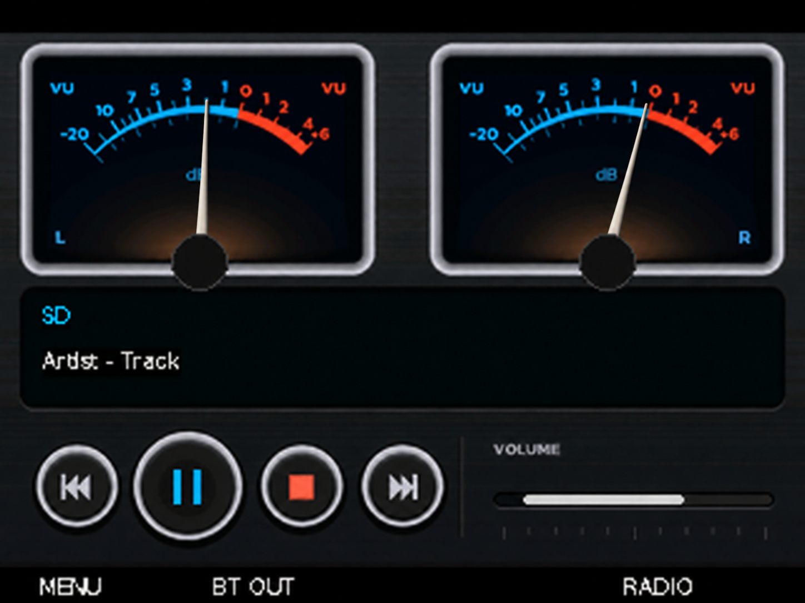

<em>Korábbi mutatós elrendezési terv.</em>

<h3 align="center">Service</h3>

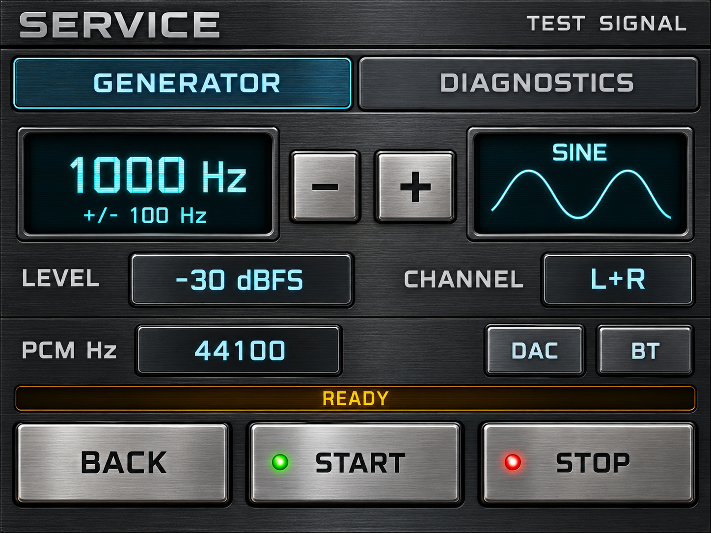

<em>R146 Service látványterv, példaértékekkel; nem készülékfotó vagy kalibrált műszer.</em>

<h3 align="center">Classic Wood</h3>

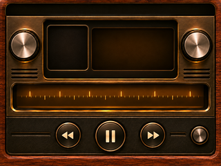

<em>Statikus háttér; élő feliratok nélkül. Forráskód: <a href="https://github.com/szupert/I-BT-Radio-/tree/main/skins/source">skinforrások</a>.</em>

<h3 align="center">Vintage HiFi</h3>

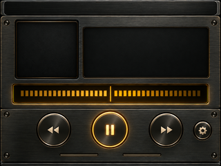

<em>Statikus háttér; élő feliratok nélkül. Forráskód: <a href="https://github.com/szupert/I-BT-Radio-/tree/main/skins/source">skinforrások</a>.</em>

<h3 align="center">Retro Neon</h3>

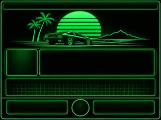

<em>Statikus háttér; ez a külön vintage téma. Forráskód: <a href="https://github.com/szupert/I-BT-Radio-/tree/main/skins/source">skinforrások</a>.</em>

<h3 align="center">Neon</h3>

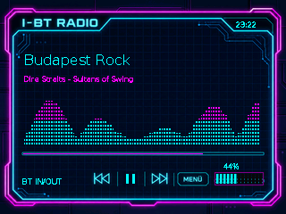

<em>Az R137 rajzolókódjával készült előnézet, példaadatokkal és szemléltető spektrummal. Forráskód: <a href="https://github.com/szupert/I-BT-Radio-/tree/main/skins/source">skinforrások</a>.</em>

<h3 align="center">Ébresztőóra / Alarm clock</h3>

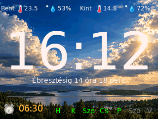

<em>R124 óralap-előnézet példaadatokkal, bekapcsolt fényképes háttérrel. Forráskód: <a href="https://github.com/szupert/I-BT-Radio-/tree/main/skins/source">skinforrások</a>.</em>

<h3 align="center">Időjárás / Weather</h3>

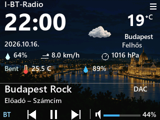

<em>R130 éjszakai előnézet példaadatokkal; nem élő időjárásmérés. Forráskód: <a href="https://github.com/szupert/I-BT-Radio-/tree/main/skins/source">skinforrások</a>.</em>

<h3 align="center">Bluetooth IN</h3>

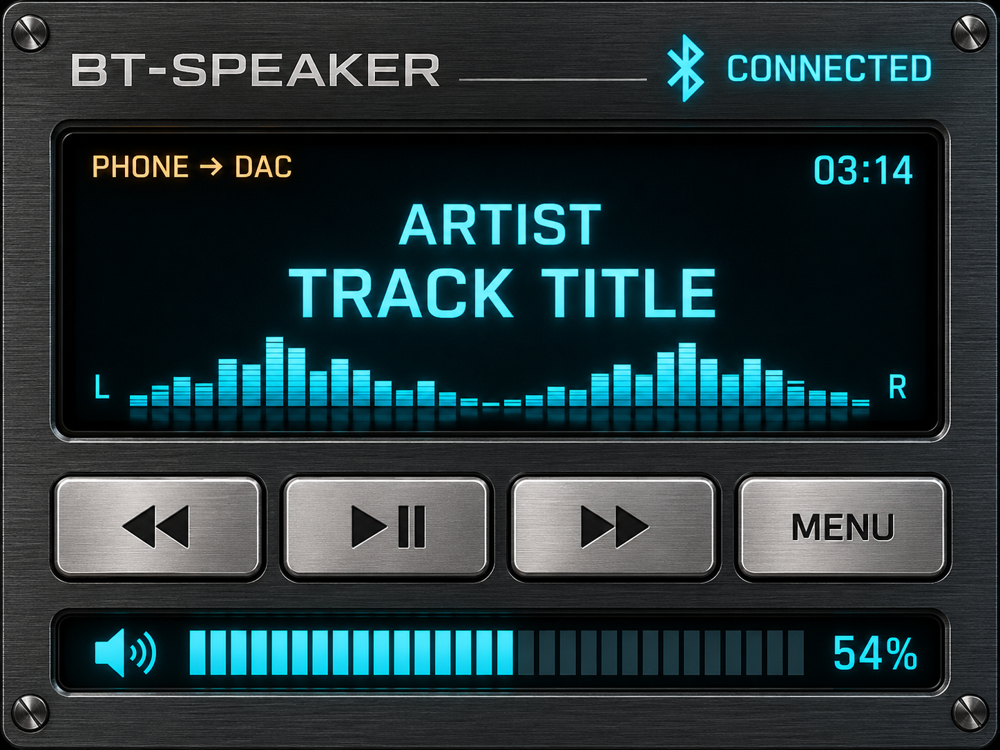

<em>R146 BT-Speaker látványterv, példaadatokkal; nem készülékfotó.</em>

A Wi-Fi-hang → BT továbbra is tiltott, az EQ hangfeldolgozás kikapcsolt. A Winamp EQ-görbéje látványelem. A galéria nem új nyilvános firmware-kiadás.

<h3 align="center">Videoton RT 6303 S</h3>

<table align="center">
<tr><th align="center">Betöltő</th><th align="center">Lejátszó</th></tr>
<tr><td align="center"><a href="skins/videoton-rt6303s-320x240/boot.png">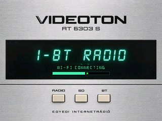</a></td><td align="center"><a href="skins/videoton-rt6303s-320x240/player.png">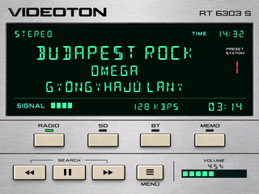</a></td></tr>
</table>

<em>Az elfogadott eredeti Videoton-felületet tartottam meg, felirat → LED → üres gomb sorrenddel és RT 6303 S típusfelirattal. Az R143-ban a bootképből eltűntek a zöld szövegmaradványok, a betöltősáv tisztán rajzolódik. A BT gomb menü nélkül IN módra váltott, a telefonról folyamatosan szólt a hang. A 36 oldalas, 255 menüsort érintő rövid rajzolási próbában nem tért vissza a veremtúlcsordulás. Az előnézeten példaadatok látszanak; az előnézet nem teljes firmware-minősítés. Forráskód: <a href="https://github.com/szupert/I-BT-Radio-/tree/main/skins/source">skinforrások</a>.</em>

## További változatok

[BIG P4 / JC1060](beta/BIG_P4_JC1060_DEV1/README.md) · [Korábbi LIGHT és PRO kiadások, skingaléria és panelbekötések](KORABBI_KIADASOK_ES_SKINEK.md) · [Forrás](source/README.md) · [Licencek](THIRD_PARTY_NOTICES.md)

## Támogatás

Ha szívesen támogatnád a projektet, itt megteheted. A támogatásból új ESP-paneleket, az általatok javasolt más paneleket és fejlesztőeszközöket veszek, hogy többféle hardveren is elérhetővé és jobbá tehessem a rádiót. Ha van ilyen paneled, vagy szívesen küldenél egyet, vedd fel velem a kapcsolatot.

- **Ethereum (ETH):** `0xf044db3277a1b880713e81d66b6E507F65450EE6`
- **Bitcoin (BTC):** `3KLgXnbCs1WCD3igiVErxdy2CAH7QWchLs`
- **PayPal:** `LT253250028810624563`
