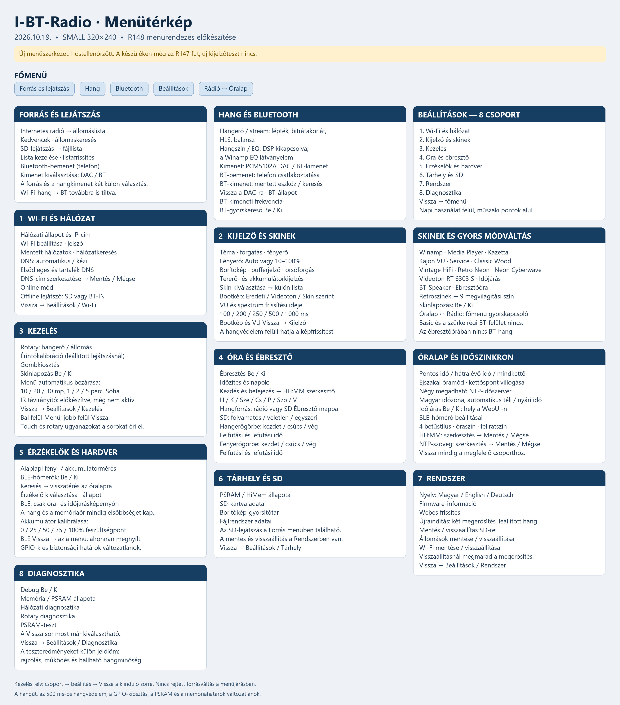

# Menü és kezelés · 2026.10.19.

Az R147 skinlapozása a készüléken jól működött. A Basic playert és a szürke régi Bluetooth-felületet eltávolítottam. A következő firmware menüjét az alábbi szerkezetre rendeztem át. **Ez előkészített változat: hostteszt és célprocesszoros szintaktikai ellenőrzés sikeres, teljes build és fizikai menüteszt még nincs. A rádión továbbra is az R147 fut.**

[A teljes méretű JPG megnyitása](../../hardware/MENU_MAP.jpg)

## Főmenü

Forrás és lejátszás · Hang · Bluetooth · Beállítások · Rádió / Óralap.

A hangforrást és a hangkimenetet külön választom: például SD → DAC vagy SD → BT. A Wi-Fi-hang → BT továbbra is tiltva van, az EQ hangfeldolgozása kikapcsolva marad. Az ébresztőóra nem fogad és nem küld BT-hangot. A BLE-hőmérő csak óra- és időjárásképernyőn működhet, a hang és a memóriaőr elsőbbségével.

## Beállításcsoportok

| Csoport | Mit találok benne? |
|---|---|
| Wi-Fi és hálózat | Kapcsolat, mentett hálózatok, keresés, DNS, online és offline mód |
| Kijelző és skinek | Téma, forgatás, fényerő, skin, bootkép, borító, puffer, térerő, akkumulátor, VU-frissítés |
| Kezelés | Rotary, érintőkalibráció, gombkiosztás, skinlapozás, menübezárási idő; IR előkészítve |
| Óra és ébresztő | Időzítés, hét napjai, rádió/SD hangforrás, hangerő- és fényerőgörbe, óralap, négy NTP-szerver |
| Érzékelők és hardver | Alaplapi fény- vagy akkumulátormérés, BLE-hőmérők, akkukalibráció |
| Tárhely és SD | PSRAM/HiMem, SD, borítógyorsítótár és fájlrendszer állapota |
| Rendszer | Nyelv, firmware-információ, webes frissítés, újraindítás, SD-mentés és visszaállítás |
| Diagnosztika | Debug, memória, hálózat, rotary és PSRAM-teszt |

A skinlista 13 megmaradó felületet tartalmaz. A Service és a BT-Speaker külön felület; a régi szürke BT-kép és a Basic nem tér vissza a választóba. A skinlapozási kapcsoló a Felület listában is elérhető ugyanannak a beállításnak a gyorskapcsolójaként.

## Visszalépés és kezelés

A bal felső Menü és a jobb felső Vissza mellett minden csoportnak saját Vissza sora van. A visszalépés a megfelelő szülőmenü megfelelő sorára visz: a bootképtől a Kijelzőhöz, a menübezárási időtől a Kezeléshez. A BLE-listából oda jutok vissza, ahonnan megnyitottam. A Diagnosztika korábban nem választható Vissza sorát javítottam.

Az érintés és a rotary ugyanazokat a menüpontokat éri el. A skinváltáshoz egy oldalirányú húzás egy váltást jelent; a húzás felengedése nem válhat playlist-koppintássá. Az óra/percszerkesztő és a szöveges NTP-szerkesztő külön Mentés és Mégse műveletet használ. Újraindításhoz és visszaállításhoz megmarad a megerősítés.

## Mi van ténylegesen ellenőrizve?

- R147: a skinlapozás a készüléken jól működött. A rövid megfigyelésben a kijelző legkisebb veremtartaléka 1552 B volt; új reset és memóriahiba nem jelent meg. A hallható hangminőséget most nem tudtam ellenőrizni.
- Új menüváltozat: 3855 fordítási/határértékes szövegkiírás és a mozgatott menüpontok oda-vissza útja hoston ellenőrizve. A célprocesszoros szintaktikai ellenőrzés sikeres. Ez nem teljes firmware-build vagy készülékteszt.
- A négyórás R147 DAC-teszt külön mérés, BT-IN és BT-OUT nélkül. A futás közben elkészült menüváltozat nem módosítja a rádión lévő firmware-t.

A korábbi [2026.10.11-i menüvizsgálat](results/STRESS_20261011_151229_617.json) történeti előzmény. A régi runner és WEB→BT-kísérlet nem írja felül a jelenlegi tiltásokat és nem igazolja az új menü fizikai működését. A kirajzolt sor, a végrehajtott művelet és a hallható hang három külön ellenőrzés.

Csak képet és leírást publikálok; ez a frissítés nem tartalmaz skinforrást vagy firmware-t.
