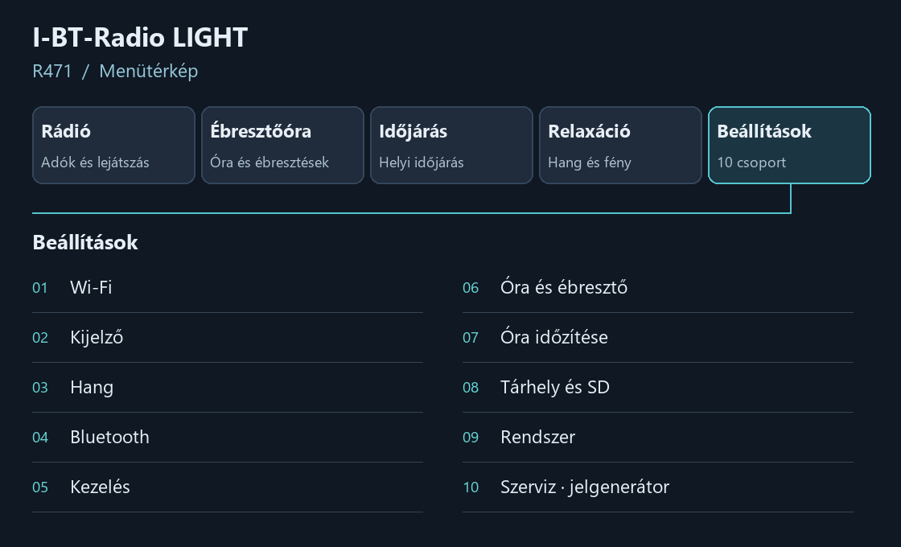
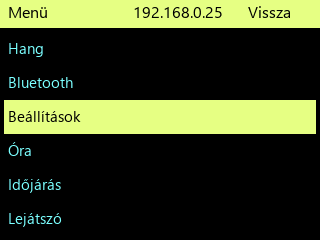

# LIGHT menütérkép · R471

| Főmenü csempéje | Mit nyit meg? |
|---|---|
| Rádió | Lejátszó, adóváltás, lejátszásvezérlés és forrásválasztás |
| Ébresztőóra | Óranézet, érintésre óravezérlés és az ébresztések beállítása |
| Időjárás | Az időjárás kijelzése a beállított helyhez |
| Relaxáció | Hang, Fény, Kombinált mód és programválasztás |
| Beállítások | Az alábbi csoportok a kijelző sorrendjében |

1. Wi-Fi
2. Kijelző
3. Hang
4. Bluetooth
5. Kezelés
6. Óra és ébresztő
7. Óra időzítése
8. Tárhely és SD
9. Rendszer
10. Szerviz · jelgenerátor

**Borító és VU:** Beállítások → Kijelző → Borítókép és VU. Ugyanitt, a Kijelző menüben állítható a fényerő, a tájolás, a betűméret és az animáció.

**Akadozó adás:** Beállítások → Hang → Hangpuffer. Az adatpuffer és az újratöltések száma segít összehasonlítani két adót.

**Érintéskalibrálás:** Beállítások → Kezelés → Érintés. Az időzített óranézet a Beállítások → Óra időzítése sorból érhető el.

---

## Korábbi menütérképek

# Light R270 · menü és kezelés

A főmenü sorrendje: **Hang · Bluetooth · Beállítások · Óra · Időjárás · Lejátszó**.

- **Beállítások → Gombok és forgatógomb → Koppintás**: „Kijelölt sor” az alap. Húzással/rotaryval jelölj ki egy sort; a listaterületen bárhová koppintva azt nyitod meg. „Érintett sor” módban a megérintett sor azonnal megnyílik. A választás elmentődik. Ez a normál menüre, állomás-/SD-/kedvenclistára és keresési találatokra érvényes. A billentyűzet, BT-eszköz- és Wi-Fi-hálózatválasztó továbbra közvetlenül a megérintett elemet kezeli.
- **Vissza röviden**: szülőoldal. A fejléc Vissza gombját kb.800 ms-ig tartva közvetlenül a főképernyőre lépsz; a már működő BT-kapcsolatot nem bontja.
- **Forrás** a lejátszón: WIFI-DAC, SD-DAC, SD-BT, BT-DAC. SD-BT hangszórót/fülest keres, BT-DAC a telefon hangját fogadja.
- **SD a bal felső sarokban**: fájllista. **Wi-Fi-jel**: hálózati menü. A Kapcsolatok/bootkép **Wi-Fi gombja** új hálózathoz hotspotot indít; BT gombja telefon→DAC.
- Sikeres SD-BT csatlakozás után a főképernyő jelenik meg; az SD-tartalom külön nyitható.
- Lapozásos módváltás a Gombok és forgatógomb alatt kapcsolható; lejátszó/óra/időjárás között. Időjárás alatt nincs lejátszás.
- Boot: kijelző→SD→BT-támogatás→tényleges Wi-Fi. Az utolsó zöld jelzés után2s; háttér egyszer, majd csak változó jelzések. A BT bootjelzés a támogatás készenlétét jelzi, nem párosított eszközt.
- A piros túlterhelésjelző megmarad; ne küldj sorozatos új parancsokat, amíg a rendszer foglalt.

[Előképek](../../skins/light-320x240/) · [Tesztelési útmutató és ismert hibák](../LIGHT_R270_TEST_GUIDE.md)

Az R251–R268 különböző működéseiről vannak felhasználói visszajelzések. Az R269 címadat/BT-görgetés és R270 új koppintás/lista/boot-villogás javítása gépen ellenőrzött, friss készülékes PASS még nincs.
