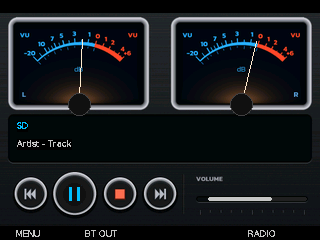

# Skin-Galerie

Stand: 2026-10-13. Acht grafische Oberflächen; der Uhrmodus ist eine separate Funktion. Die Bilder sind statische Hintergründe oder frühere Layout-Vorschauen, keine vollständigen R83-Laufzeitaufnahmen. Dynamische Menüs, Akku-, Empfangs- und EQ-Anzeigen können abweichen. Diese Galerie-Aktualisierung ist keine neue Firmware und kein Stabilitätsnachweis.

[Magyar](README.md) · [English](README.en.md) · [Deutsch](README.de.md)

## Winamp / Classic

## Media Player

## Cassette

## Kajon-Jon-bt-vu

## Service

## Classic Wood

## Vintage HiFi

## Retro Neon

