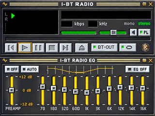
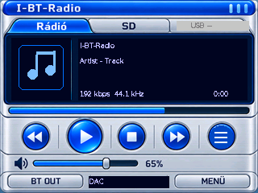
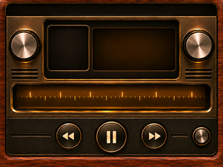
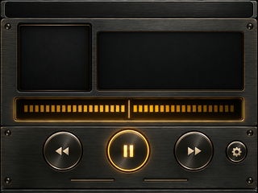
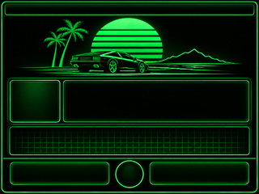
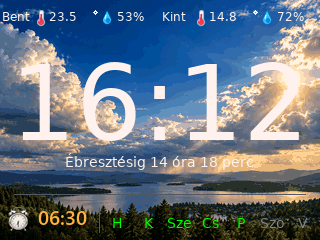
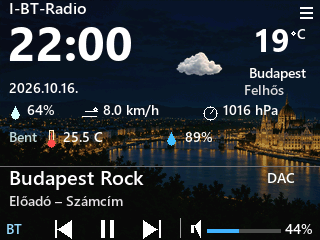
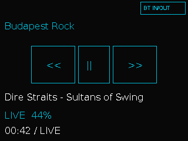
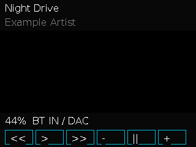

# Skins

Aktualisiert: 17. Oktober 2026 · V166-R137 Entwicklung

Ich zeige elf Skins und die beiden einfachen Systemansichten: Basisplayer und BT-IN. Die Vorschauen sind zentriert und 320 Pixel breit. Frühere Layout-Vorschauen, statische Hintergründe und mit Zeichencode erzeugte Ansichten kennzeichne ich getrennt. Sie ersetzen keinen Anzeigetest am Gerät.

Winamp, BT-IN und Service sind Ausnahmen: Ihr Quellcode darf veröffentlicht werden. Dieses Galerie-Update enthält nur Bilder und Beschreibungen.

<h3 align="center">Winamp / Classic</h3>

<em>Frühere Layout-Vorschau.</em>

<h3 align="center">Media Player</h3>

<em>Frühere Layout-Vorschau. Auf Wunsch des Auftraggebers halte ich den Quellcode auf unbestimmte Zeit privat. Auf gesonderte Anfrage veröffentliche ich ihn mit Erlaubnis des Eigentümers.</em>

<h3 align="center">Cassette</h3>

<em>Statischer Hintergrund; Metadaten erscheinen bei der Wiedergabe. Auf Wunsch des Auftraggebers halte ich den Quellcode auf unbestimmte Zeit privat. Auf gesonderte Anfrage veröffentliche ich ihn mit Erlaubnis des Eigentümers.</em>

<h3 align="center">Kajon-Jon-bt-vu</h3>

<em>Frühere Layout-Vorschau mit Zeigeranzeigen. Auf Wunsch des Auftraggebers halte ich den Quellcode auf unbestimmte Zeit privat. Auf gesonderte Anfrage veröffentliche ich ihn mit Erlaubnis des Eigentümers.</em>

<h3 align="center">Service</h3>

<em>Signalgenerator und Diagnose; kein kalibriertes Messgerät.</em>

<h3 align="center">Classic Wood</h3>

<em>Statischer Hintergrund ohne dynamische Beschriftung. Auf Wunsch des Auftraggebers halte ich den Quellcode auf unbestimmte Zeit privat. Auf gesonderte Anfrage veröffentliche ich ihn mit Erlaubnis des Eigentümers.</em>

<h3 align="center">Vintage HiFi</h3>

<em>Statischer Hintergrund ohne dynamische Beschriftung. Auf Wunsch des Auftraggebers halte ich den Quellcode auf unbestimmte Zeit privat. Auf gesonderte Anfrage veröffentliche ich ihn mit Erlaubnis des Eigentümers.</em>

<h3 align="center">Retro Neon</h3>

<em>Statischer Hintergrund; das separate Vintage-Thema. Auf Wunsch des Auftraggebers halte ich den Quellcode auf unbestimmte Zeit privat. Auf gesonderte Anfrage veröffentliche ich ihn mit Erlaubnis des Eigentümers.</em>

<h3 align="center">Neon</h3>

<em>Vorschau mit R137-Zeichencode, Beispieldaten und illustrativem Spektrum. Auf Wunsch des Auftraggebers halte ich den Quellcode auf unbestimmte Zeit privat. Auf gesonderte Anfrage veröffentliche ich ihn mit Erlaubnis des Eigentümers.</em>

<h3 align="center">Ébresztőóra / Alarm clock</h3>

<em>R124-Uhrvorschau mit Beispieldaten und aktiviertem Fotohintergrund. Auf Wunsch des Auftraggebers halte ich den Quellcode auf unbestimmte Zeit privat. Auf gesonderte Anfrage veröffentliche ich ihn mit Erlaubnis des Eigentümers.</em>

<h3 align="center">Időjárás / Weather</h3>

<em>R130-Nachtvorschau mit Beispieldaten; keine aktuelle Wettermessung. Auf Wunsch des Auftraggebers halte ich den Quellcode auf unbestimmte Zeit privat. Auf gesonderte Anfrage veröffentliche ich ihn mit Erlaubnis des Eigentümers.</em>

<h3 align="center">Alapnézet / Basic player</h3>

<em>R137-Basisansicht mit Beispieldaten. Auf Wunsch des Auftraggebers halte ich den Quellcode auf unbestimmte Zeit privat. Auf gesonderte Anfrage veröffentliche ich ihn mit Erlaubnis des Eigentümers.</em>

<h3 align="center">Bluetooth IN</h3>

<em>R137-BT-IN-Bildschirm mit Beispieldaten, ohne Cover.</em>

WLAN-Audio → BT bleibt gesperrt, die EQ-Signalverarbeitung abgeschaltet. Die Winamp-EQ-Kurve ist dekorativ. Dieses Galerie-Update ist keine neue öffentliche Firmware-Veröffentlichung.

