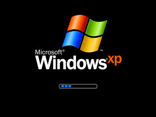
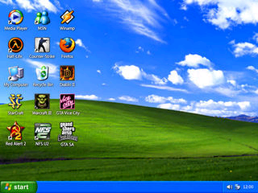
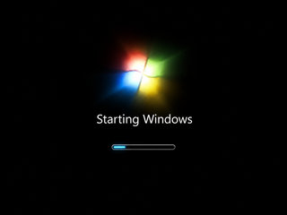
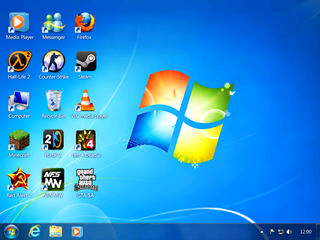
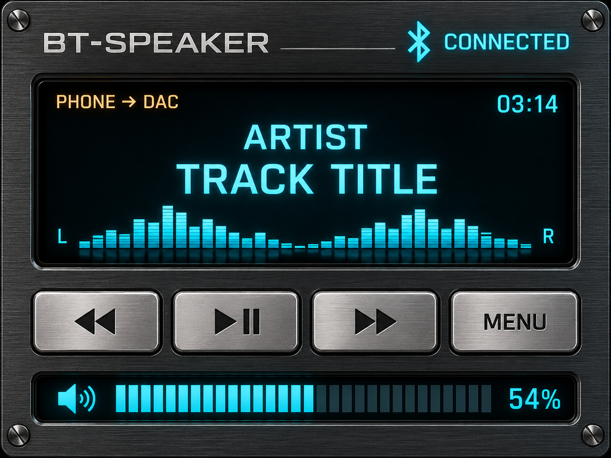

# Skinek

Frissítve: 2026. október 19. · R161 indulási előnézetek

A galériában 13 megmaradó felület előnézetét mutatom, köztük a Videoton lejátszót és bootképet, a Service és az új BT-Speaker képernyőt. A képek középre rendezve, 260–320 pixel szélességgel jelennek meg. Az Alapnézet / Basic player képeit kérésre eltávolítottam. A látványterveket, statikus háttereket és host-rajzokat külön jelölöm.

Ebben a frissítésben kizárólag előnézeti képeket és leírásokat publikálok; forráskódot és firmware-t nem töltök fel.

<h3 align="center">Winamp / Classic</h3>

<table align="center">
<tr><th align="center">Betöltő</th><th align="center">Asztal · 2 mp</th><th align="center">Lejátszó</th></tr>
<tr><td align="center"></td><td align="center"></td><td align="center"></td></tr>
</table>

<em>Korábbi grafikai előnézet.</em>

<em>Az R161 indulási sorrendjét egymás mellett mutatom. Az asztalon 15 korabeli program és játék ikonja szerepel, köztük Red Alert 2, Need for Speed és GTA: San Andreas. A képek előnézetek; az R161 készülékes képi és hangpróbája még hátravan.</em>

<h3 align="center">Media Player</h3>

<table align="center">
<tr><th align="center">Betöltő</th><th align="center">Asztal · 2 mp</th><th align="center">Lejátszó</th></tr>
<tr><td align="center"></td><td align="center"></td><td align="center"></td></tr>
</table>

<em>Korábbi grafikai előnézet. Megrendelői kérésre bizonytalan ideig a forráskódot privátként kezelem. Külön kérésre, a tulajdonos engedélyével publikálom.</em>

<em>Az R161 indulási sorrendjét egymás mellett mutatom. Az asztalon 15 korabeli program és játék ikonja szerepel, köztük Red Alert 2, Need for Speed és GTA: San Andreas. A képek előnézetek; az R161 készülékes képi és hangpróbája még hátravan.</em>

<h3 align="center">Cassette</h3>

<em>Statikus háttér; a feliratok lejátszáskor kerülnek rá. Megrendelői kérésre bizonytalan ideig a forráskódot privátként kezelem. Külön kérésre, a tulajdonos engedélyével publikálom.</em>

<h3 align="center">Kajon-Jon-bt-vu</h3>

<em>Korábbi mutatós elrendezési terv.</em>

<h3 align="center">Service</h3>

<em>R146 Service látványterv, példaértékekkel; nem készülékfotó vagy kalibrált műszer.</em>

<h3 align="center">Classic Wood</h3>

<em>Statikus háttér; élő feliratok nélkül. Megrendelői kérésre bizonytalan ideig a forráskódot privátként kezelem. Külön kérésre, a tulajdonos engedélyével publikálom.</em>

<h3 align="center">Vintage HiFi</h3>

<em>Statikus háttér; élő feliratok nélkül. Megrendelői kérésre bizonytalan ideig a forráskódot privátként kezelem. Külön kérésre, a tulajdonos engedélyével publikálom.</em>

<h3 align="center">Retro Neon</h3>

<em>Statikus háttér; ez a külön vintage téma. Megrendelői kérésre bizonytalan ideig a forráskódot privátként kezelem. Külön kérésre, a tulajdonos engedélyével publikálom.</em>

<h3 align="center">Neon</h3>

<em>Az R137 rajzolókódjával készült előnézet, példaadatokkal és szemléltető spektrummal. Megrendelői kérésre bizonytalan ideig a forráskódot privátként kezelem. Külön kérésre, a tulajdonos engedélyével publikálom.</em>

<h3 align="center">Ébresztőóra / Alarm clock</h3>

<em>R124 óralap-előnézet példaadatokkal, bekapcsolt fényképes háttérrel. Megrendelői kérésre bizonytalan ideig a forráskódot privátként kezelem. Külön kérésre, a tulajdonos engedélyével publikálom.</em>

<h3 align="center">Időjárás / Weather</h3>

<em>R130 éjszakai előnézet példaadatokkal; nem élő időjárásmérés. Megrendelői kérésre bizonytalan ideig a forráskódot privátként kezelem. Külön kérésre, a tulajdonos engedélyével publikálom.</em>

<h3 align="center">Bluetooth IN</h3>

<em>R146 BT-Speaker látványterv, példaadatokkal; nem készülékfotó.</em>

A Wi-Fi-hang → BT továbbra is tiltott, az EQ hangfeldolgozás kikapcsolt. A Winamp EQ-görbéje látványelem. A galéria nem új nyilvános firmware-kiadás.

<h3 align="center">Videoton RT 6303 S</h3>

<table align="center">
<tr><th align="center">Betöltő</th><th align="center">Lejátszó</th></tr>
<tr><td align="center"></td><td align="center"></td></tr>
</table>

<em>Az elfogadott eredeti Videoton-felületet tartottam meg, felirat → LED → üres gomb sorrenddel és RT 6303 S típusfelirattal. Az R143-ban a bootképből eltűntek a zöld szövegmaradványok, a betöltősáv tisztán rajzolódik. A BT gomb menü nélkül IN módra váltott, a telefonról folyamatosan szólt a hang. A 36 oldalas, 255 menüsort érintő rövid rajzolási próbában nem tért vissza a veremtúlcsordulás. Az előnézeten példaadatok látszanak; a többi funkció teljes ellenőrzése még folyamatban van. Megrendelői kérésre bizonytalan ideig a forráskódot privátként kezelem. Külön kérésre, a tulajdonos engedélyével publikálom.</em>

