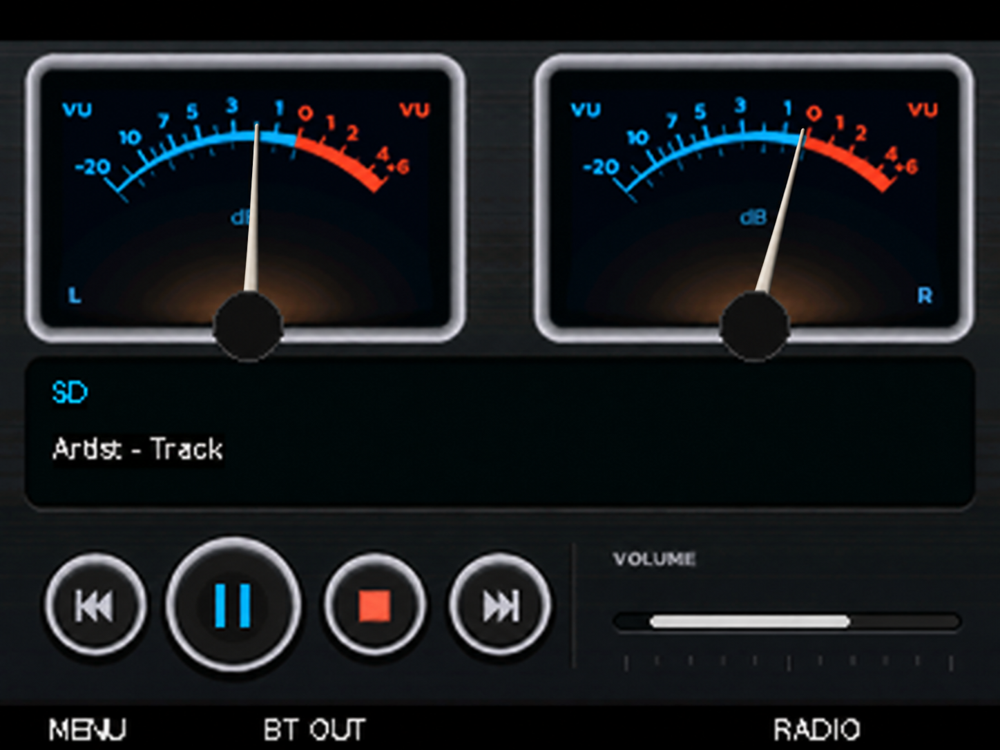

# Kajon-Jon-bt-vu skin

[Magyar](README.md) · [Deutsch](README.de.md)

Twin VU meters and metallic controls, with a matching menu and playlist. The skin is selected in Settings → Display → Appearance → KAJON VU in V166-R33.

## Approved pointer design

A wider base tapering smoothly to a fine tip, with subtle depth, softly antialiased edges and a restrained shadow.

This enlarged generated preview is a design reference, not a 320 × 240 firmware asset. The original player.png and RGB565 background remain unchanged. Pointer-renderer integration is pending; the R33 installer has not changed. Physical display/audio validation: NOT_RUN.

[Current renderer preview](player.png) · [Menu](menu.png) · [Playlist](playlist.png)

The original artwork came from the supplied KAJON_VU_PLAYER.rar. Its artwork license has not been independently verified; this publication does not grant a new license for it. The yoRadio code license does not automatically cover this artwork.
