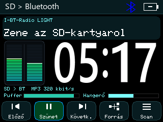
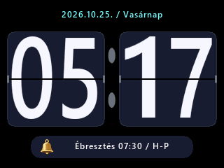
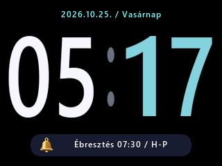
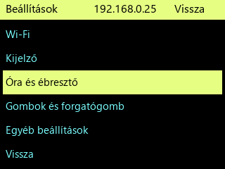
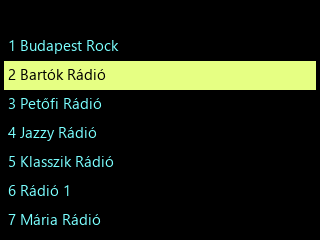
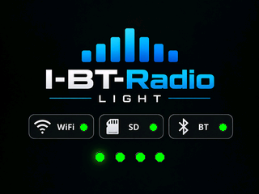
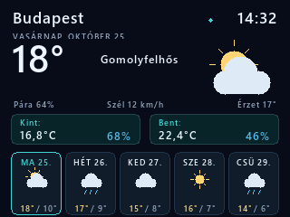
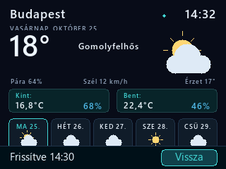

# Light4MB · R270 előképek

A képek a jelenlegi rajzolók gépi előnézetei, mintaadatokkal; nem készülékfotók vagy élő API-mérések. A bootkép a firmware RGB565 gyári képe, szemléltető kész állapotjelzéssel. Az állomáslista-kép csak a listaterületet mutatja. R270 készülékes ellenőrzés még szükséges. Nincs nagy framebuffer vagy új skingaléria az eszközön.

| Lejátszó | Lapozós óra | Digitális óra |
|---|---|---|
|  |  |  |

| Menü | Beállítások | Állomáslista |
|---|---|---|
|  |  |  |

| Boot / Kapcsolatok | Időjárás + Kint/Bent BLE | Érintésre előjövő vezérlők |
|---|---|---|
|  |  |  |

[Telepítő](../../beta/4MB_PSRAM_NELKUL/R270/) · [Menüútmutató](../../docs/menu/) · [Ismert hibák és próba](../../docs/LIGHT_R270_TEST_GUIDE.md)
