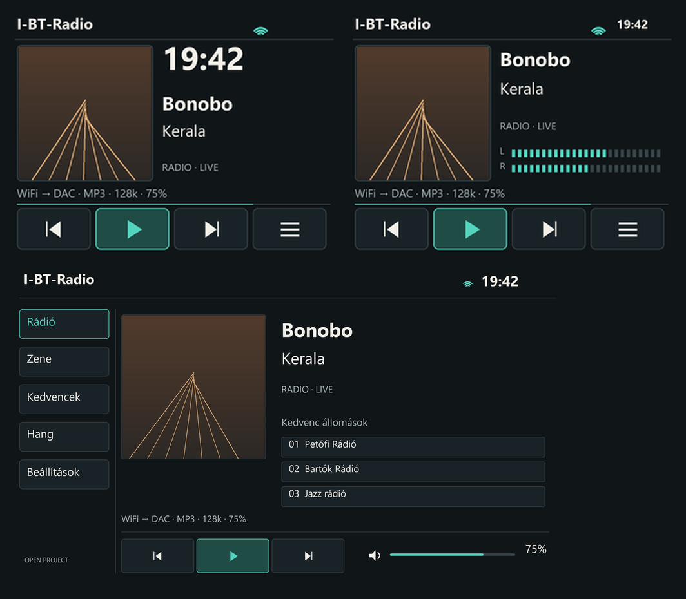
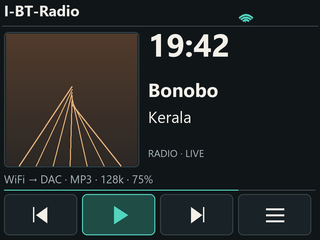
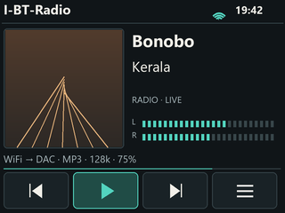
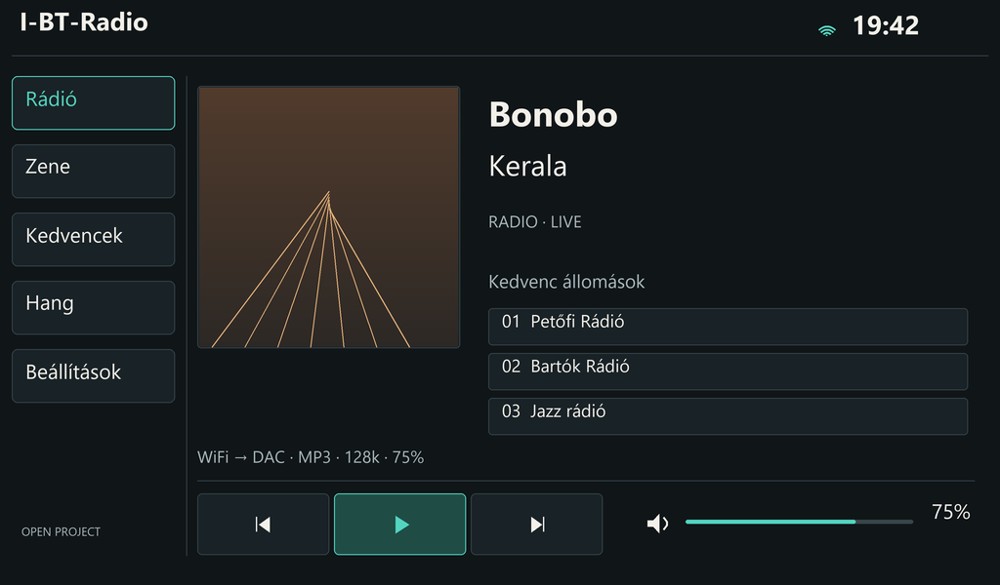

# Modern HiFi — SMALL / PRO / BIG

Az I-BT-Radio nyílt projekt új, egységes grafikai skin-csomagja.

| Változat | Méret | Előnézet | Elrendezés |
|---|---|---|---|
| SMALL | 320×240 | [PNG](small/preview.png) | [JSON](small/layout.json) |
| PRO | 320×240 | [PNG](pro/preview.png) | [JSON](pro/layout.json) |
| BIG / JC1060P470C | 1024×600 | [PNG](big/preview.png) | [JSON](big/layout.json) |

[Teljes csomag letöltése](Modern-HiFi-Skins.zip)

## SMALL · 320×240

## PRO · 320×240

## BIG · 1024×600

*A képek látványtervek bemutatóadatokkal, nem készülékfotók.*

## Tartalom és használat

Mindhárom változat szerkeszthető SVG-t, natív méretű PNG hátteret, RGB565 little-endian hátteret és elrendezési adatokat tartalmaz. A preview bemutatóadatokat és szintetikus mintaborítót használ. A background fájlban nincs beégetett előadó, számcím vagy óra; ezeket a firmware rajzolja majd rá. Az ikonok külön SVG/PNG fájlok.

Ez grafikai fejlesztői csomag, **nem telepíthető firmware**, és még nem választható skin a jelenlegi firmware-ben. A dinamikus mezők, érintési események, szövegcsonkolás/görgetés, ikonállapotok és menüoldalak firmware-integrációja, majd készülékes ellenőrzése hátravan. Nincs új hang-, hálózati vagy DSP-funkció ebben a csomagban.

SMALL/PRO háttér: 153600 bájt; BIG háttér: 1228800 bájt. Ez a nyers fájl mérete, nem előírt RAM-foglalás. SMALL-on soronkénti vagy régiónkénti kirajzolást kell alkalmazni, új teljes framebuffer nélkül. Az 1 pixeles puffercsík és az AW jelzés dinamikus; AW a WiFi melletti szabad állapotrégióba kerül, 100%-nál eltűnik. A teljes képernyős borítónézet és a meglévő működés megőrzése az integráció feltétele. Az új főképernyő nem helyettesíti a menüben meglevő 2 pixeles margószabályt.

Újragenerálás: `python generate.py` (Python + Pillow, Windows Segoe UI betűkészlet). A Segoe UI betűfájl nincs a csomagban. A validation.json a méretet, RGB565 színsorrendet, teljes 16 bites konverziót és veszteségmentes RGB565 körutat ellenőrzi. Készülékes sebesség-, hang- és érintési teszt még nem történt.

Forrás és eredet: [I-BT-Radio nyílt projekt](https://github.com/szupert/I-BT-Radio-). A grafika programozott, szerkeszthető UI-elemekből készül; nem egy generált képernyőkép kivágása. Nincs benne személyes hálózati adat, valódi zeneborító, napló vagy firmware bináris. A projekt licencfeltételei az irányadók; új, eltérő licenc nincs megadva.
