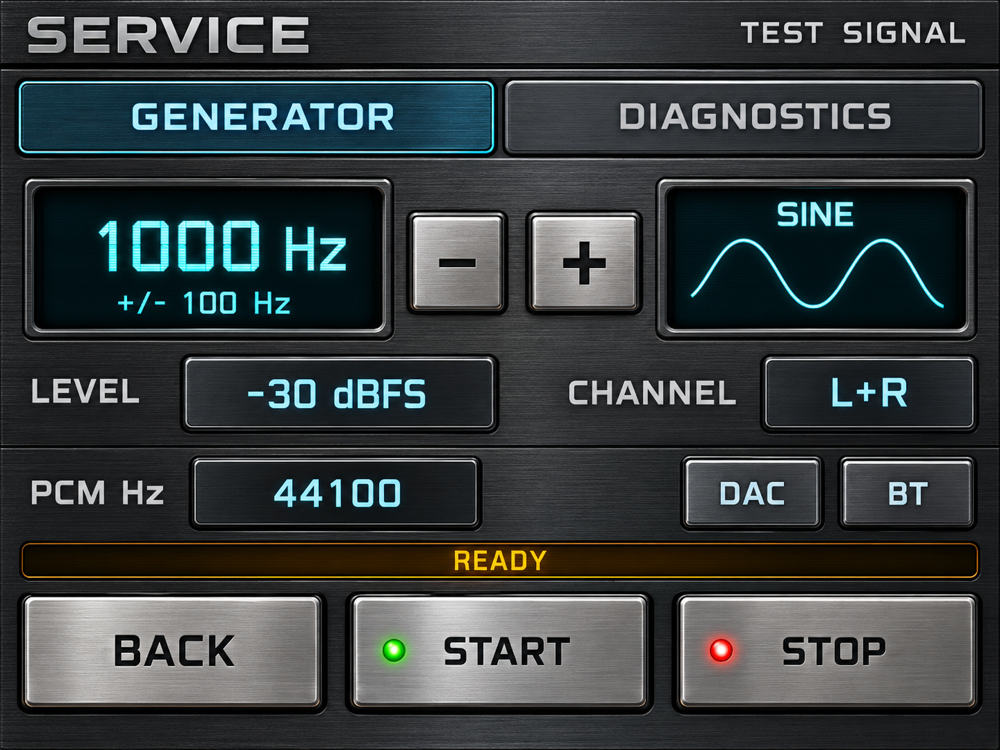

# Service

Frissítve: 2026. október 19. · V166-R146 fejlesztői állapot

<em>Látványterv példaadatokkal; nem készülékfotó.</em>

<em>A 320×240-es rajzolókóddal készült host-előnézet, példaadatokkal. A host a keret- és körprimitíveket közelíti; ez nem teljes fizikai pixelteszt.</em>

A meglévő jelgenerátort és diagnosztikát az új fémhatású gombokra kötöttem. A generátor nem indul el pusztán a képernyő megnyitásától. A fizikai gomb- és hangpróba eredményét külön naplózom.

Ebben a frissítésben csak képeket és leírást publikálok. Forráskódot, firmware-t és nyers képadatokat nem töltök fel.

[Teljes galéria](../README.md).
