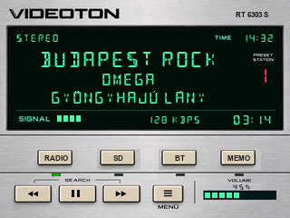
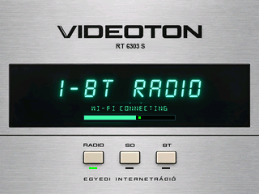

# Videoton RT 6303 S

A kipróbált R141 ezüst Videoton-felületét tartottam meg. Itt a gombfeliratok, a LED-ek és a típusfelirat célzott grafikai javítását mutatom, példaadatokkal. Az új rajz készülékes ellenőrzése még hátravan; ez nem firmware-kiadás.

Megrendelői kérésre bizonytalan ideig a forráskódot privátként kezelem. Külön kérésre, a tulajdonos engedélyével publikálom.
